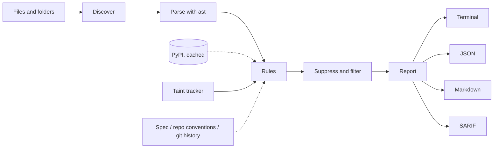

# How it works



1. **Discover.** Walk the given paths, skip the usual build and environment folders, and keep files
   the enabled rules care about (Python for most rules; also `.env`, YAML, JSON, TOML, INI and shell
   files for secrets).
2. **Parse.** Python files are parsed with the standard library's `ast`. Code is never imported or
   run. A file that does not parse becomes finding INC-08, and the other rules skip it.
3. **Rules.** Each rule is a small class that looks at one file and yields findings. A rule that crashes
   is reported as a warning and never stops the scan.
4. **Suppress and filter.** Inline `# slopguard: ignore[...]` comments, per-rule path ignores, the
   baseline and `--severity` remove findings.
5. **Report.** Terminal, JSON, Markdown or SARIF.

## The taint tracker

Most of the LLM rules ask one question: **can data from a risky place reach a dangerous place?**
slopguard tracks three kinds of flow, each with its own sources and sinks.

| Flow | Starts at (source) | Ends at (sink) | Rules |
| --- | --- | --- | --- |
| Model output | The return value of an SDK call such as `client.messages.create`, `client.chat.completions.create`, `llm.invoke` | `eval`/`exec`, shell, SQL text, file paths, request URLs | LLM-02 to LLM-06 |
| Untrusted input | `input()`, `request.args`/`form`/`json`, `sys.argv`, fetched pages | The system prompt of a model call, or a prompt string built with an f-string or `+` | LLM-01 |
| Tool arguments | The parameters of a function decorated with `@tool` (or passed to `Tool(func=...)`) | The same dangerous sinks as model output | LLM-08 |

A value stays "tainted" as it moves through assignments, attribute access, subscripts, f-strings,
`str.format` and common string methods. It becomes clean when it passes through a **sanitizer**
(`ast.literal_eval`, `shlex.quote`, `int`, and any you add in [configuration](configuration.md)), or when
the variable is reassigned with something safe.

Each finding carries the path it found, so you can see the reasoning:

```text
↳ line 21: model output from client.messages.create()
↳ line 21: stored in `reply`
↳ line 27: passed to eval()
```

Confidence is lower when a value was only *guessed* to be risky (a parameter named `llm_output`) than
when it was seen coming from a model call.

### What it cannot see

This is a deliberate trade for speed and few false alarms. Say so honestly: **a clean result is not a
proof of safety.**

- It does not follow values **across functions**: if `ask()` returns model output and a different
  function calls `eval(ask())`, that is missed.
- It does not follow values stored on **`self`** or other objects.
- It does not know about SDKs it has no pattern for; add yours under `[taint.sources]`.
- It cannot tell that a validation function really validates. Add it as a sanitizer, or accept that
  a finding may remain.

Both cross-function and `self` cases are labelled as known misses in the benchmark corpus, so they are
measured, not hidden.

## Other checks

| Area | How it works |
| --- | --- |
| Packages (HAL) | Import names are mapped to PyPI distribution names (with a table of aliases such as `yaml` to `pyyaml`), then looked up on PyPI. Answers are cached for 24 hours. Typosquats are names one edit away from a list of popular packages. Imports in `try/except ImportError`, inside functions, or under `TYPE_CHECKING` are reported with lower severity |
| Incompleteness (INC) | AST checks for stubs and swallowed errors, token checks for comments and chat residue. Functions whose docstring explains the intent (hook, override, no-op) are skipped, and empty *methods* are low severity because they are usually hooks |
| Secrets (SEC) | Provider-specific patterns, plus assignments to names like `token` or `password` whose values look like credentials (a digit or symbol, enough entropy, not an environment-variable name, URL or placeholder) |
| Spec (SPC) | Each requirement is matched against names, strings and docstrings in the code; backticked names are looked up as definitions. With `--llm`, the best-matching functions go to a model for a reasoned verdict |
| Drift (DRF) | Mines naming, library and idiom statistics from files outside the change, then flags deviations. Needs at least three other Python files |
| Regression (REG) | Parses `git diff` of test files for removed tests, added skips and fewer assertions; optionally runs the suite at the base ref in a temporary worktree and now |
| Repair | Sends a file and its findings to a model, then accepts the proposal only if it parses, is not much shorter, reduces serious findings and introduces none |

## Measuring it

Rules are tuned against three things, all reproducible from the repository: a labelled corpus
(`slopguard bench`), other scanners on that corpus (`benchmarks/compare.py`), and 1.5 million lines of
well-reviewed packages as a false-positive control (`benchmarks/realworld.py`). See the
[benchmarks](benchmarks.md) and the [real-world check](real-world-check.md), including their caveats.
